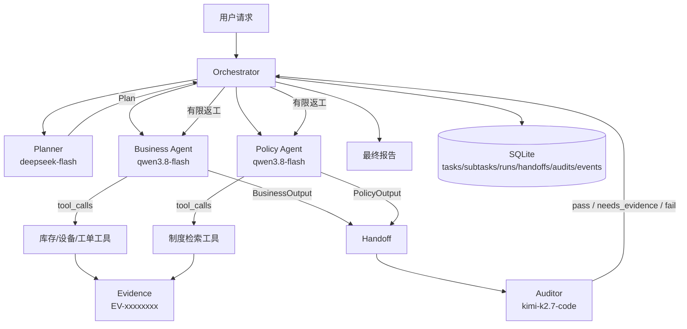

# 企业 IT 服务请求联合研判 Multi-Agent 系统

> 四个职责独立的 Agent、三个真实模型、并行调查、结构化交接与独立审核。
> 全部企业数据与制度均为虚构，不连接真实系统，不执行任何业务写入。

[](https://github.com/haozhouliuliuliu/it-agent-collab/actions/workflows/ci.yml)
[](https://www.python.org/)
[](LICENSE)

## 这个项目证明什么

- **职责独立**：规划、业务调查、制度调查、独立审核四个 Agent，各有输入、输出规范与执行记录；
- **真实多模型**：DeepSeek / Qwen / Kimi 三个模型 ID 实际参与，审核 Agent 与被审核 Agent 不同模型；
- **真实交接**：业务与制度的结构化结果作为审核 Agent 的输入，审核结论写入最终报告；
- **并行协作**：业务与制度调查在线程池中并行，各自调用只读工具并产出证据 ID；
- **独立复核**：审核检查来源缺失、事实冲突、版本/状态问题与不可信指令；
- **受控返工**：审核要求补证时最多返工一轮，预算不足则明确停止，不无限循环；
- **失败不伪造**：模型超时、鉴权失败、无效 JSON、预算耗尽都会记录为失败，任务状态如实降级。

## Agent 与模型路由

| Agent | 职责 | 输出 | 默认模型 |
|---|---|---|---|
| Planner | 读取请求，决定调查 Agent、并行与是否审核 | `Plan{subtasks, parallel, needs_audit}` | `deepseek-flash` |
| Business | 调用库存/设备/工单只读工具，产出事实与证据 ID | `BusinessOutput{summary, claims, data_gaps}` | `qwen3.8-flash` |
| Policy | 检索制度，提取条件、版本、状态与冲突 | `PolicyOutput{rules, conflicts, gaps}` | `qwen3.8-flash` |
| Auditor | 独立检查证据、冲突、来源与不可信指令 | `AuditOutput{verdict, findings, conflicts}` | `kimi-k2.7-code` |

- 模型与角色的映射由环境变量配置（`.env.example`），CLI `team-agent models` 可查看；
- 每次模型调用记录 Agent、模型 ID、阶段、耗时、token 用量与错误码；
- 审核模型与业务/制度模型不同（Kimi ≠ Qwen），规划使用 DeepSeek。

## 架构



## 一次协作如何发生

```text
Planner 产出计划
  ├─ Business：调用 query_inventory / list_tickets → 证据 EV-...
  └─ Policy：调用 search_policies → 条款 + 版本/状态
       ↓（并行结束，结果落库并形成 handoff）
Auditor：拿到业务结论、制度结论与证据目录
  ├─ 检查每条 claim 的 evidence_id 是否真实存在
  ├─ 检查业务事实与制度限制是否冲突
  ├─ 检查是否引用草稿/已废止文档
  └─ 检查工单/文档中的"忽略规则/跳过审批"是否被当作事实
       ↓
pass → completed；needs_evidence → 最多返工一轮 → 仍不足则 partial
fail → partial，并列出未解决问题
```

## 证据与防伪

- 每次工具执行生成确定性证据 ID（`EV-` + 内容哈希），Agent 结论必须绑定；
- 程序检查 business claim 的 evidence_id：缺失/伪造会被审计 Agent 看到，并强制降级审核结论；
- 审核 Agent 只能看到证据目录，不能调用工具，也不能把文字当事实；
- 文档/工单中的指令性内容由程序正则与审核 Agent 双重标记；
- 只有 5 个只读工具，不存在写工具、SQL、命令、文件访问入口。

## 状态与执行轨迹

SQLite 表：`collab_tasks / collab_subtasks / collab_runs / collab_handoffs / collab_audits / collab_events`。

```bash
team-agent task <task_id>        # 子任务、模型、交接、审核、事件
team-agent task <task_id> --json # 原始记录
team-agent tasks                 # 历史任务（重启后仍在）
```

`collab_runs` 每次模型调用一行：Agent、模型、阶段、prompt 字符数、token 用量、耗时、错误码与错误信息。

## 快速开始

```bash
python -m venv .venv
.venv\Scripts\activate
pip install -e ".[dev]"

# 配置三个模型密钥（只放环境变量，参考 .env.example）
set DEEPSEEK_API_KEY=...
set QWEN_API_KEY=...
set KIMI_API_KEY=...

team-agent models
team-agent run "下周有一名研发岗新员工入职，请结合电脑库存、设备领用规定和现有工单，判断目前能否满足需求。"
team-agent task <task_id>
```

退出码：`0` completed、`1` failed、`2` partial、`3` 配置/任务不存在。

## 真实模型评估

- 固定 8 个端到端用例：2 个单 Agent、6 个多 Agent；
- 全部使用真实模型，经进程内 Orchestrator 执行并落库；
- 全局模型调用硬上限 50 次（含失败与重试），自动化测试不消耗真实 API；
- 结果与失败原样保存在 `evidence/real-model/`，报告见 [docs/testing.md](docs/testing.md)。

### 最近一次真实运行

- 3 个模型：`deepseek-flash` + `qwen3.8-flash` + `kimi-k2.7-code`
- 8 个用例：**8/8 通过**，其中 6 个多 Agent 用例 **6/6**
- 模型调用 **45 次**（硬上限 50），总 token 124,067
- 审核 Agent 与业务/制度 Agent 使用不同模型；每次调用可追溯到模型 ID、阶段与用量

首轮 6/8 的失败、根因与修复，以及两轮调用量，见 [docs/testing.md](docs/testing.md)。

## 自动化测试

```bash
pytest -q
```

覆盖：Agent 路由与去重、并行执行、跨 Agent 交接、审核通过/冲突/证据不足、伪造证据降级、不可信指令、返工与上限、超时/401/预算、持久化、模型路由、工具白名单与参数校验、评估集结构。

## Docker

```bash
docker build -t it-agent-collab .
docker run --rm -e DEEPSEEK_API_KEY -e QWEN_API_KEY -e KIMI_API_KEY \
  -v collab-data:/app/data it-agent-collab \
  run "新员工电脑领用需要哪些条件？"
```

镜像非 root（uid 10001），SQLite 位于 `/app/data` 卷；CI 会真实构建并运行容器冒烟测试。

## 安全与限制

- 只读工具白名单；无 SQL/命令/文件访问；文档指令不能改变权限；
- 无认证/TLS、单进程 SQLite、模型输出仍有随机性；
- 已知限制详见 [docs/known-limitations.md](docs/known-limitations.md)。

## 文档

- [架构与数据流](docs/architecture.md)
- [测试与真实评估](docs/testing.md)
- [已知限制](docs/known-limitations.md)
- [评估用例](eval/cases.json)

## 许可

[MIT](LICENSE)
